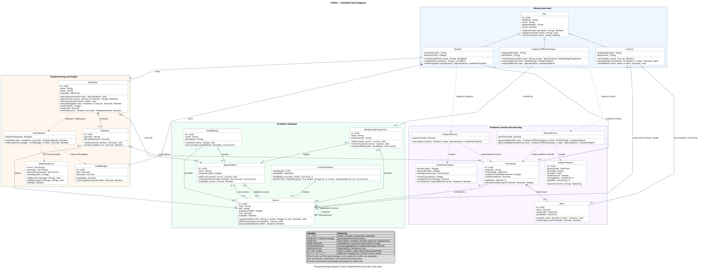

# Lab 6 — Detailed Class Diagram

## Project and scope

**InPlan** helps students create individual study plans, select a specialization, allocate their credit budget, and track academic progress. Lecturers assign marks; academic office employees maintain model study programmes and generate academic reports.

This is a **proposed object-oriented design**, based on the [functional and non-functional requirements](../lab3/task3.md) and [use case diagram](../lab4/task4.md). The repository contains requirements rather than an application implementation, so class names, operation signatures, and the assumptions below are design decisions, not reverse-engineered code.

Baseline: [`aeea8fb09ff3cc2169b04ad9d80d4dcc4158f800`](https://github.com/InnoSoftwareArchitectureTeam/main/tree/aeea8fb09ff3cc2169b04ad9d80d4dcc4158f800).

## Diagram



Open the [vector diagram](class-diagram.svg) separately to zoom in, or use the [single-page vector PDF](class-diagram.pdf) for submission. The PDF is a large-format sheet intended for zooming; fitting it onto A4 will make the text small. The editable source is [class-diagram.puml](class-diagram.puml). The diagram uses standard UML notation rendered with PlantUML; it is intentionally independent of a programming language or database framework.

## Assignment checklist

| Requirement | Evidence |
| --- | --- |
| At least 10 classes | **20 classes**, including one abstract base class. |
| Name, attributes, and methods for every class | Every class has a name, typed attributes, and typed operations; every class has at least one operation with a parameter. |
| Visibility | Every attribute and operation has a visibility marker. `+` is public, `-` is private, `~` is package visibility. Abstract operations are italicized. |
| At least 4 relationship types | **5 types:** generalization, association, composition, shared aggregation, and dependency. |
| Cardinalities on all associations | Multiplicities appear at **both ends of all 20 association relationships**, including compositions, aggregations, and the recursive prerequisite relationship. |
| At least one example of parameter directionality | Explicit `in`, `out`, and `inout` parameters, including `PlanValidator.validate` and `PlanValidator.reallocate`. |

## Classes and responsibilities

| Class | Responsibility |
| --- | --- |
| `User` (abstract) | Shared identity, password verification, contact information, and the abstract permission operation. |
| `Student` | Owns study plans, a credit budget, and academic history; views marks and progress. |
| `Lecturer` | Assigns or revises marks for courses the lecturer is authorized to teach. |
| `AcademicOfficeEmployee` | Creates model study programmes and requests academic reports. |
| `FieldOfStudy` | Classifies courses and specializations. |
| `Course` | Describes an available course, academic credits, cost, and prerequisites. |
| `CourseCatalogue` | Finds courses and filters available courses by field, credits, and specialization. |
| `Specialization` | Defines eligible courses, mandatory core courses, and required academic credits. |
| `ModelStudyProgramme` | Holds a reusable selection of courses for a specialization and compares it with an individual plan. |
| `StudyPlan` | Manages selected courses, specialization, allocations, totals, validation, and explicit confirmation. |
| `PlanItem` | Represents one course selected for a semester and its budget allocation. |
| `CreditBudget` | Tracks the student's spending limit and total allocated amount. |
| `PlanValidator` | Checks plan constraints and performs guarded budget changes. |
| `ValidationResult` | Returns errors, warnings, missing core courses, and missing credits to the caller. |
| `Enrollment` | Preserves a confirmed student–course registration, its semester, and credit/cost snapshots. |
| `Mark` | Stores the final result for an enrollment and evaluates it against a pass threshold. |
| `ProgressService` | Calculates specialization progress from the student's passed enrollments. |
| `AcademicProgress` | Represents earned and required credits, remaining credits, and missing core courses. |
| `ReportService` | Produces academic reports grouped by field of study or specialization. |
| `AcademicReport` | Holds report scope, timestamp, summary statistics, and an export operation. |

## Relationships and multiplicities

| Type | Example | Meaning |
| --- | --- | --- |
| Generalization | `Student --|> User` | A student inherits identity and common behavior from `User`. All three role subclasses implement `hasPermission`. |
| Association | `Student "1" -- "0..*" StudyPlan` | Every study plan belongs to exactly one student; a student may have no plans or several plans. |
| Composition | `StudyPlan "1" *-- "0..*" PlanItem` | A plan item belongs exclusively to one plan and has no independent lifetime. Removing a draft plan removes its items. |
| Shared aggregation | `ModelStudyProgramme "0..*" o-- "0..*" Course` | A programme groups reusable courses. Courses may occur in several programmes and survive programme deletion. |
| Dependency | `ReportService ..> AcademicReport` | The service creates a result during a call; it does not retain a permanent association with each generated report. |

The diamond is at the whole/owner end. An arrow on a solid association indicates navigability; it is not a new relationship type. Generalizations and dependencies do not have association multiplicities.

Additional relationships express these rules:

- A student owns exactly one `CreditBudget`; every budget belongs to exactly one student.
- A course belongs to one `FieldOfStudy` and may have multiple authorized lecturers. A lecturer may teach multiple courses.
- A course can require multiple other courses and can be a prerequisite for multiple dependent courses. The two ends of the recursive association have distinct role labels.
- A specialization has at least one core course and may accept additional elective courses. Its core-course set must be a subset of its eligible-course set.
- A draft plan can have no selected specialization (`0..1`). Multiple plans can target the same specialization.
- Each `PlanItem` selects exactly one course. After confirmation, an item can reference one enrollment; an enrollment may outlive that reference (`0..1` at both ends).
- Every enrollment belongs to exactly one student and one course. It may initially have no mark and later have one final mark (`0..1`). A mark belongs exclusively to one enrollment.
- A mark references exactly one lecturer as its most recent author. A lecturer may be the last author of many marks.
- A model programme targets exactly one specialization and records exactly one creating academic office employee.

## Parameter directionality

```text
+validate(in plan : StudyPlan, out result : ValidationResult) : Boolean
```

`plan` is input: validation reads it without changing it. `result` is output: the validator creates the result, including any errors and warnings, and assigns it for the caller. The Boolean return value indicates whether confirmation is allowed. A failed check still produces a populated result, allowing the interface to display missing courses or credits (FR-09, FR-10).

```text
+reallocate(inout budget : CreditBudget, in delta : Decimal) : Boolean
```

`budget` is both input and output: the validator reads its current allocation and changes the same object if the delta is valid. `delta` is input only. A positive delta allocates more budget; a negative delta releases an allocation. If the change would exceed the limit or make the allocation negative, the method returns `false` and leaves the budget unchanged.

`in`, `out`, and `inout` are UML parameter directions, not required keywords in the eventual implementation language. The visibility prefix `+` is separate from the parameter direction.

## Design assumptions and constraints

The requirements leave some academic rules open. The following choices make this lab model concrete and should be confirmed before implementation.

1. **Roles and access.** The initial model treats student, lecturer, and office employee as separate account types. Supporting several roles on one account would require a role-assignment model. All user-facing operations require an authenticated session. Students may mutate only their own plans; mark changes require the actor to be linked to the enrollment's course; programme management and reporting require an office role. Package-visible mutators are internal operations, not public API endpoints. The class diagram does not specify session storage or HTTP controllers.
2. **Academic credits and budget are separate.** `Course.academicCredits` measures study load. `Course.cost`, `PlanItem.allocatedAmount`, and the budget fields use the same decimal budget unit; no currency or conversion rate is assumed. Academic credits and costs must be nonnegative, with strictly positive credits for a credit-bearing course. The budget unit and university-specific limits remain to be agreed.
3. **A single budget covers all plans.** `CreditBudget.allocated` equals the sum of item allocations across the student's retained plans, including committed allocations in confirmed plans. The invariant is `0 <= allocated <= limit`. `StudyPlan.allocateBudget` changes the item and the shared budget atomically. Removing a draft item releases its allocation. Concurrent edits must not overspend the budget; transaction/locking details are outside this diagram. Negative budgets and allocations are rejected.
4. **Draft versus confirmed plans.** Status is one of `DRAFT` or `CONFIRMED`. Drafts may be incomplete. Confirmation requires a specialization, all core courses, enough eligible academic credits, available courses, and full course funding. Each allocation must be between zero and that course's cost. Missing prerequisites produce warnings, as FR-23 says, rather than an invented mandatory rejection rule. Cyclic/self prerequisites and invalid catalogue data are rejected when maintaining courses.
5. **Explicit confirmation and academic history.** `confirm(actor, result)` is the student's explicit action. It validates ownership and constraints, then atomically creates an enrollment for each item and marks the plan confirmed. Failure creates none; repeated confirmation creates no duplicates. Confirmed plans are read-only in this initial design: post-start changes need a separately agreed amendment policy. Enrollment and mark records are retained even if a plan reference is later removed. The academic record is therefore not composed into the plan item. Course cost and credits are snapshotted at enrollment so later catalogue edits do not rewrite academic history.
6. **Courses and specialization.** One course and one specialization each belong to one field in this simplified model. A plan cannot select the same course twice, and a student cannot have duplicate enrollments for the same course and semester. A course may be shared across specializations and model programmes. A programme can be empty while being edited. `compareWith(plan)` returns programme courses absent from the plan; catalogue filtering by specialization uses its eligible-course set.
7. **Marks and progress.** There is one final mark per enrollment; revision updates it. The grading scale and `passThreshold` are configurable university rules, not fixed numbers invented here. Both services use the same threshold. Planned credits count selected courses; earned credits count only passed, specialization-eligible courses. Repeated passes of the same course count once, using the earliest passing enrollment's credit snapshot. A specialization is complete only when its credit threshold and all core courses are satisfied. `remainingCredits()` is `max(0, requiredCredits - earnedCredits)`; the percentage is capped at 100, but 100% credits alone does not imply completion if a core course is missing.
8. **Reports.** Report metrics are proposed output fields because FR-20/21 do not specify their exact contents. Field reports use enrollments whose course belongs to that field. Specialization reports use enrollments linked to confirmed plans selecting that specialization. `studentCount` counts distinct students in the scope, `averageMark` averages recorded final marks, and `passRate` is passing marks divided by recorded marks. Ungraded enrollments are excluded from mark statistics; empty mark sets yield absent (`0..1`) statistics, not a misleading zero. Historical specialization reporting after amendments would require preserving the original specialization context.
9. **Coverage boundary.** Recommendations and a dashboard (FR-26/27) are optional and are not modeled. Validation messages are returned to the interface; this does not require inventing an email or notification delivery service. Audit history, storage, UI, and infrastructure are not expanded into classes here. In particular, the latest-author link on `Mark` is not a complete change audit. Persistence, audit, concurrency, and performance NFRs still require implementation and verification; a static diagram does not demonstrate them.

## Traceability to requirements

| Requirements | Classes and operations |
| --- | --- |
| FR-01, FR-02, FR-25 | `CourseCatalogue.findById/filter`, `Course`, `FieldOfStudy`, eligible courses of `Specialization`. |
| FR-03, FR-04 | `StudyPlan.addCourse/removeCourse`, composed `PlanItem` objects. |
| FR-05, FR-06 | `StudyPlan.selectSpecialization`, `Specialization` and its core-course association. |
| FR-07–FR-10 | `StudyPlan.totalCredits`, `PlanValidator.validate`, `ValidationResult`. |
| FR-11–FR-13 | `StudyPlan.allocateBudget/totalCost`, `CreditBudget`, `PlanValidator.reallocate`. |
| FR-14, FR-15 | `AcademicOfficeEmployee.createProgramme`, `ModelStudyProgramme.addCourse/removeCourse`. |
| FR-16, FR-17 | `Lecturer.assignMark/reviseMark`, `Enrollment`, `Mark`, `Student.viewMarks`. |
| FR-18, FR-19, FR-22 | `ProgressService.calculate`, `AcademicProgress.remainingCredits/isComplete`. |
| FR-20, FR-21 | `ReportService.generateByField/generateBySpecialization`, `AcademicReport`. |
| FR-23 | Recursive course prerequisites, `Course.prerequisitesMet`, validation warnings. |
| FR-24 | `ModelStudyProgramme.compareWith`. |
| FR-28 | `StudyPlan.confirm` requires explicit student action before creating enrollments. |
| NFR-01–NFR-08 | Identity and role hierarchy, ownership and teaching associations, guarded mutations and validation constraints described above. These model the intended responsibilities, not proof of enforcement. |

## Re-rendering

With Java, PlantUML, and Graphviz installed, run this from the repository root:

```bash
java -jar /path/to/plantuml.jar -tsvg lab6/class-diagram.puml
```

The checked-in SVG can be viewed without installing these tools. For syntax, see the [official PlantUML class diagram documentation](https://plantuml.com/class-diagram).
