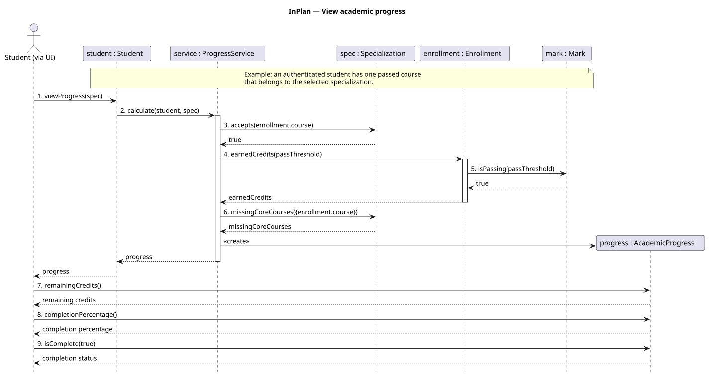

# Lab 7 — UML Sequence Diagram

Scenario: an authenticated student views academic progress toward a selected specialization.

The sequence refines the proposed design in [Lab 6](https://github.com/InnoSoftwareArchitectureTeam/main/blob/117f6eff8bc56992ceb1248eff9482495909a6a2/lab6/task6.md), especially design assumption 7. All six participant classes and all ten distinct method names are present in the [detailed class diagram](https://github.com/InnoSoftwareArchitectureTeam/main/blob/117f6eff8bc56992ceb1248eff9482495909a6a2/lab6/class-diagram.puml). This is a proposed interaction design, not a trace from implemented application code.

## Assignment checklist

| Requirement | Evidence |
| --- | --- |
| At least four existing components | Six classes: Student, ProgressService, Enrollment, Mark, Specialization, AcademicProgress. The actor is additional. |
| At least eight method calls | Eleven method-call arrows, excluding returns and object creation; ten distinct operations. A successful execution with one eligible passed enrollment traverses all eleven calls. |
| Logical interaction sequence | Request progress, examine academic history, count eligible passed courses once, identify missing core courses, construct and display progress. |
| Existing classes and methods | Names and argument order match Lab 6. Access to associated objects and stored attributes is described without inventing getter methods. |
| Optional advanced elements | A loop over enrollments, alternative flows for absent/failing marks, and optional counting of eligible courses not already counted. |

## Modeling notes

- Enrollment and Mark stand for the current instances during each iteration, rather than a single record reused for all courses.
- Enrollment traversal is chronological so the first passing enrollment of a course supplies the historical credit snapshot. Failed earlier attempts do not enter the counted set.
- The second isPassing call is the check inside earnedCredits; the service's first check also allows a passed zero-credit course to satisfy a core-course requirement.
- Creation of AcademicProgress is a UML lifecycle message, not a new public method or constructor signature added to the class model.
- The actor represents the student acting through the UI. The UI is outside the Lab 6 domain model; the last three calls read the returned result for presentation.
- Reading associated courses, academic history, requiredCredits, and credit snapshots does not imply additional public operations.
- This sequence covers progress viewing, not changes to study plans, authentication implementation, or persistence.

Editable source: [sequence-diagram.puml](sequence-diagram.puml).
